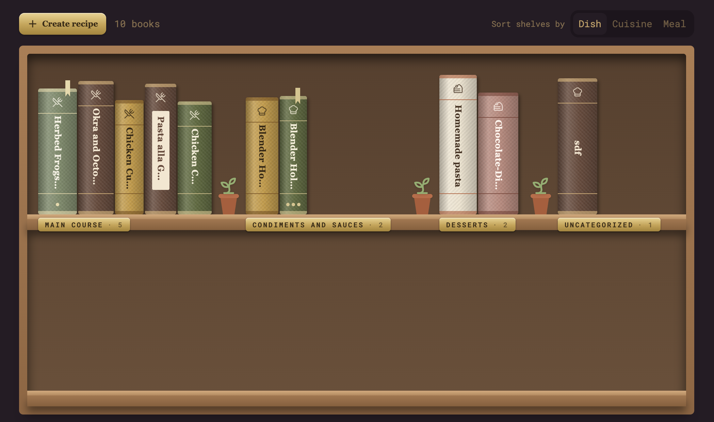
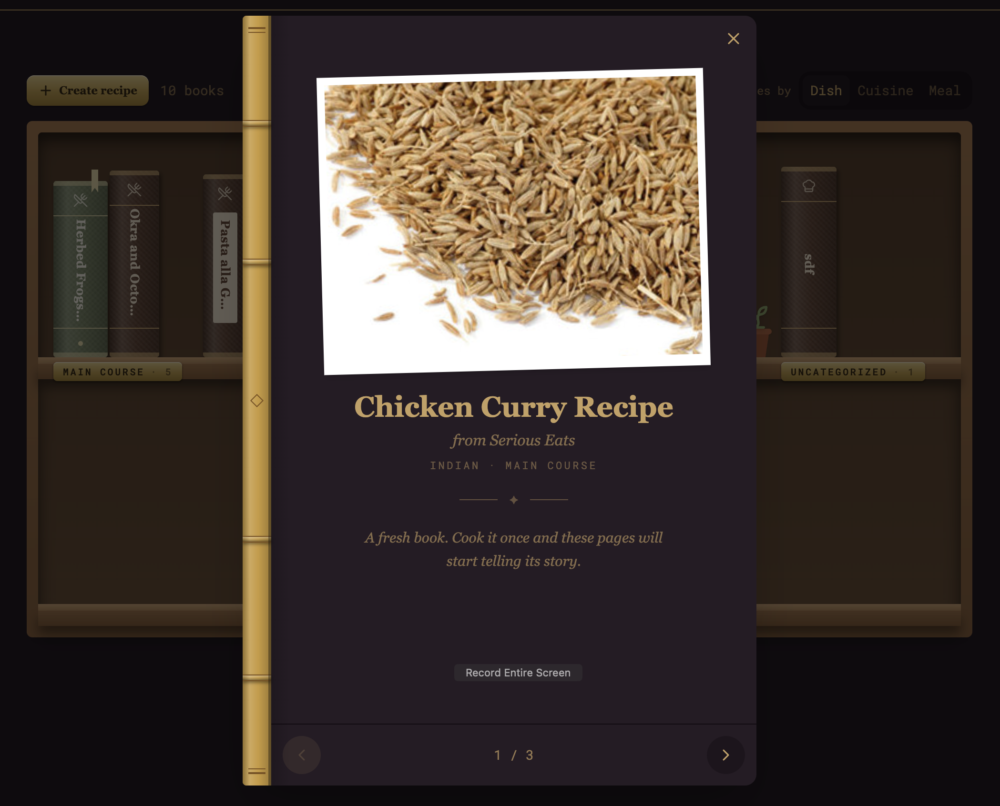
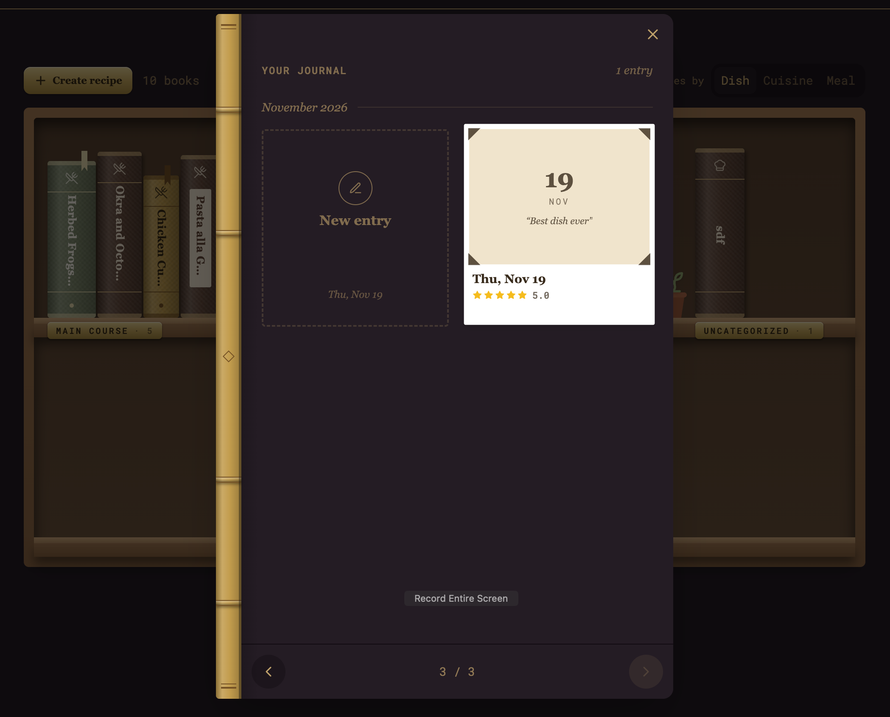

# 📖 MyCookBook

> A cooking journal: every dish you make, in one book.

**MyCookBook is a journal for the recipes you cook.** It's built for people who love making, eating and photographing good food. Every recipe is a book on your shelf, sorted your way and with you on any device. Each time you cook it, you add a page: a photo, a rating, and notes on what went well and what didn't. Over time you can look back and watch your cooking grow. The mission is simple: to make cooking something you want to keep coming back to.

🔗 **Live:** [my-cook-book-three.vercel.app](https://my-cook-book-three.vercel.app/)

## ✨ Features

- **Find recipes** from thousands on Edamam, with meal, cuisine and diet filters, or write your own.
- **A bookshelf library.** Each recipe is a book, shelved by dish, cuisine or meal. Drag a book to the trash to remove it.
- **Open a book** to see its cover, the recipe (ingredients, steps, nutrition), and its journal.
- **Journal entries** for every cook: date, photo, notes, and a star rating (half stars, or exact to 0.1).
- **Edit anything:** add your own steps or photo to any recipe; change an entry's date, rating, photo or notes later.
- **Profile stats:** meals cooked, time at the stove, your favorite recipe, what's on repeat, and your average meal's nutrition.

## 🖼️ Screenshots

<!-- Add images to docs/screenshots/ and they'll show here -->

| Your shelf | An open book | The journal |
| --- | --- | --- |
|  |  |  |

## 🛠️ Tech

Next.js (App Router) · TypeScript · Prisma + PostgreSQL (Neon) · Better Auth · TanStack Query · Tailwind CSS + DaisyUI · Motion · UploadThing · Edamam API · Vercel

## 🚀 Run it locally

You'll need **Node.js 20+** and a **PostgreSQL** database (local, or hosted like [Neon](https://neon.tech)).

```bash
git clone https://github.com/jc121w/MyCookBook.git
cd MyCookBook
npm install

cp .env.example .env      # then fill in the values (see below)
npx prisma migrate dev    # create the database tables
npm run dev               # → http://localhost:3000
```

### Environment variables

| Variable | What it's for |
| --- | --- |
| `DATABASE_URL` | PostgreSQL connection string |
| `BETTER_AUTH_SECRET` | any long random string (`openssl rand -base64 32`) |
| `BETTER_AUTH_URL` | your app's URL, e.g. `http://localhost:3000` |
| `EDAMAM_APP_ID`, `EDAMAM_APP_KEY`, `EDAMAM_USER_ID` | recipe search ([developer.edamam.com](https://developer.edamam.com)) |
| `GOOGLE_CLIENT_ID`, `GOOGLE_CLIENT_SECRET` | "Sign in with Google" (optional) |
| `GITHUB_CLIENT_ID`, `GITHUB_CLIENT_SECRET` | "Sign in with GitHub" (optional) |
| `UPLOADTHING_TOKEN` | photo uploads ([uploadthing.com](https://uploadthing.com), V7 token) |

> On Vercel, paste values **without quotes**, and redeploy after changing them.

### Handy commands

```bash
npx prisma studio          # browse and edit your data in the browser
npx prisma migrate deploy  # apply committed migrations to a production database
```

> After any `prisma migrate`, restart `npm run dev` so it picks up the new database client.

## 📁 Where things live

```
prisma/schema.prisma        Recipe (a book) and RecipeEntry (a journal page)
src/app/
  library/                  the bookshelf
  search/                   recipe search
  profile/                  your stats
  api/                      route handlers (below)
src/components/journal/     shelf, book, pages, entry form, stars
src/lib/                    auth, database, Edamam, validation, stats
```

## 📡 API routes

| Method | Route | What it does |
| --- | --- | --- |
| GET | `/api/recipes?q=` | search Edamam (with `page`, `mealType`, `cuisineType`, `diet`) |
| GET · POST | `/api/library` | your books · add an Edamam recipe to your shelf |
| GET · PATCH · DELETE | `/api/library/:id` | one book with its entries · edit it · remove it |
| POST | `/api/recipes/custom` | create your own recipe |
| POST | `/api/entries` | log a cook |
| PATCH · DELETE | `/api/entries/:id` | edit an entry (date, rating, photo, notes) · delete it |

Every route checks that you're signed in and that the book or entry is yours.

## 🗺️ Ideas for later

- [ ] Your own shelves and tags ("Weeknight", "Holidays")
- [ ] Share a book with a read-only link
- [ ] Clean up photos from forms that were cancelled
